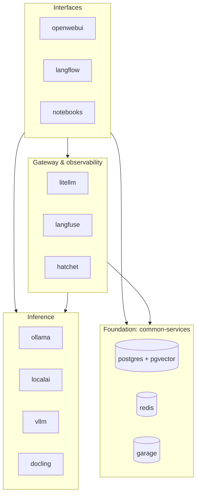
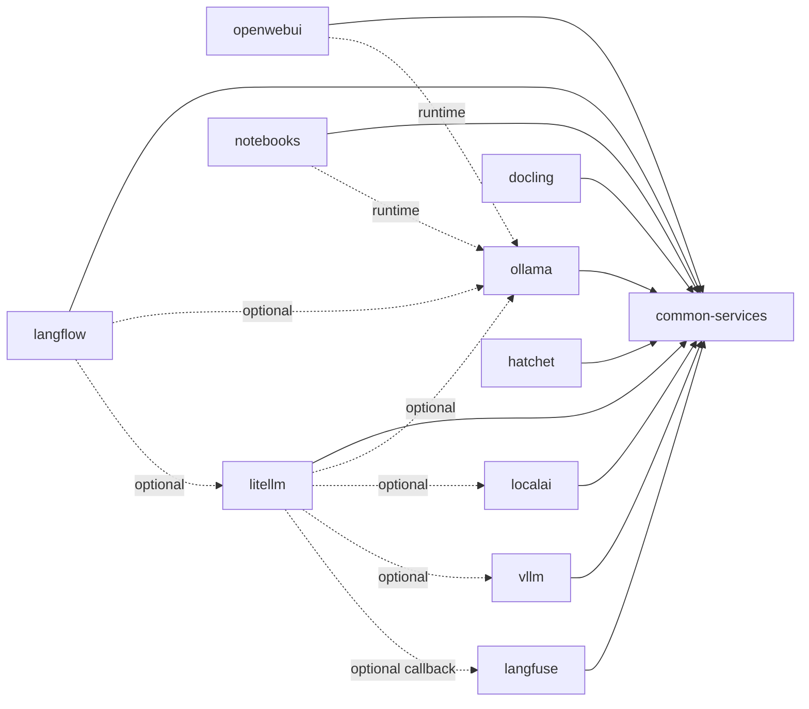

# Architecture

How llm-lab is put together: the network, module dependencies, data flows, storage and design decisions.

## Overview

llm-lab is a set of **independent Docker Compose projects** (one per folder in `modules/`) that share **one Docker network** (`lang`) and **one data layer** (`common-services`). The root `Makefile` runs `docker compose` in each module folder.

| Layer | Modules | Responsibility |
|---|---|---|
| Foundation | `common-services` | Creates the network. Provides database, cache/queues and object storage. |
| Inference | `ollama`, `localai`, `vllm`, `docling` | Load models and serve completions, embeddings and document conversion over HTTP. |
| Gateway & observability | `litellm`, `langfuse`, `hatchet` | One API in front of many backends; traces, prompts and evals; durable workflows that call the backends. |
| Interfaces | `openwebui`, `langflow`, `notebooks` | Chat, visual flows and code experiments. |

Lower layers never depend on higher ones. A module may skip layers.

## Network

- The network is named `lang`. It is **created** by `common-services` and **referenced as external** by every other module.
- Docker DNS resolves container names, so containers talk by name (`ollama`, `postgres`, `redis`, `garage`, `litellm`, `langfuse-web`, …) on the container's own port.
- From the host, use `localhost` and the published port. Inside a container, `localhost` means that container itself, a common mistake in Langflow and notebook configs.

## Dependencies and start order

Solid arrows are hard dependencies (the module fails to start without them). Dotted arrows are runtime: the module starts, but features fail until the target is up.

Compose `depends_on` only works inside a project. Order across modules comes from the `Makefile`: every module target depends on `common-services`, which also creates the databases.

## Main flows

**Chat.** The browser talks to Open WebUI, which calls Ollama. Open WebUI keeps its own state in its own volume.

**Gateway with tracing.** A client calls LiteLLM with an API key. LiteLLM checks keys in Postgres, forwards to Ollama, LocalAI or another provider, returns an OpenAI-format response, and optionally reports the trace to Langfuse. Prometheus scrapes LiteLLM metrics.

**Langfuse ingestion.** SDKs or OTLP send events to `langfuse-web`, which stores raw events in Garage (S3) and queues them in Redis. `langfuse-worker` processes them into ClickHouse. Users, projects and prompts live in Postgres.

**Document conversion.** A client uploads a file to `docling` (`/v1/convert/file`, or the async variant for long documents) and gets Markdown back. `docling` is a manager that queues the job (at most `DOCLING_MANAGER_CONCURRENCY` at once, so many clients share one capped converter). It starts `docling-worker` (docling-serve) through the Docker socket if it is stopped and runs the job on it. If the worker crashes, fails the task or gets stuck, the manager restarts it and retries. After `DOCLING_MANAGER_IDLE_TIMEOUT` seconds without work it stops the worker, freeing its RAM and VRAM.

**Workflow execution.** A client triggers a workflow through `hatchet-lite` (REST or gRPC). Hatchet stores the run in Postgres and dispatches its tasks over gRPC to workers registered with a token, retrying failed tasks. Workers run outside the lab or on the `lang` network and call `litellm`, `docling` or `ollama` from their tasks.

**RAG.** Documents are split, embedded with an Ollama embedding model and stored in a vector store (in-memory in the example notebook, or pgvector in Postgres). A query is embedded, matched, and the context plus question goes to the LLM.

## Storage

| Data | Where |
|---|---|
| Postgres databases | `common-services` named volume, mounted at `PGDATA` |
| Redis, Garage objects | `common-services` named volumes |
| Ollama models | `ollama` named volume |
| vLLM models (Hugging Face cache) | `vllm_huggingface` named volume |
| Docling models | inside the image (no volume); queued uploads and results in the manager's `/tmp` |
| LocalAI models and backends | bind mounts in `modules/localai` (git-ignored) |
| Open WebUI data | `openwebui` named volume |
| Langflow flows | Postgres; extra state in a named volume |
| Notebooks | bind mount in `modules/notebooks` |
| Prometheus data, generated LiteLLM config | `litellm` named volumes |
| ClickHouse data | `langfuse` named volumes |
| Hatchet keys and client config (runs are in Postgres) | `hatchet` named volume |

Named volumes are prefixed with the Compose project (folder) name. They survive `docker compose down`; only `down -v` removes them.

**Databases:** `langflow`, `langfuse`, `litellm` and `hatchet` (listed in `POSTGRES_DATABASES`) are created, with `vector`, by `scripts/create_databases.sh` whenever `make common-services` runs. It is idempotent.

## Ports

Every host port is a `*_PORT` variable in the module's `.env`. Check what is already taken before adding a module. Change only the **host** side of a mapping; container ports and in-network addresses stay the same, so other modules are unaffected. Admin-only ports should bind to `127.0.0.1`. ClickHouse has no host port on purpose.

## GPU

`vllm` is GPU only and always reserves one card (see [CONFIGURATIONS.md](CONFIGURATIONS.md)). `ollama`, `localai`, `docling` and `openwebui` run on CPU by default. Their `docker-compose.gpu.yml` override reserves NVIDIA GPUs, and the Makefile adds it when the NVIDIA runtime is detected. They share the GPU but compete for VRAM; on small GPUs run one inference server at a time. `docling` holds VRAM only while it has work: its manager stops the worker when idle. See [CONFIGURATIONS.md](CONFIGURATIONS.md).

## Design decisions

| Decision | Why | Trade-off |
|---|---|---|
| One Compose project per module | Start, upgrade or delete a technology independently | Cross-module order is handled by the Makefile |
| One external network | Every module reaches every other by name | No isolation; fine for a lab |
| Shared Postgres, Redis, Garage | Less RAM, one place to back up | Shared credentials; modules can collide (database names, Redis keys) |
| pgvector Postgres image | Vector search for RAG without another service | Pinned to one major version |
| `example.env` + generated `.env` | Secrets stay out of git; `make create-envs` is idempotent | Keep templates in sync when adding variables |
| Custom images only where needed | Add packages without forking upstream | Rebuild is manual (`--build`) |

## Known issues

| Issue | Impact | Fix |
|---|---|---|
| Jupyter base image uses a floating `python-3.11` tag | Rebuilds can change packages | Pin a dated tag |
| Postgres volume changed from an anonymous volume to the `postgres` named volume | A lab created before this change starts with empty databases | `pg_dumpall` from the old container before recreating it |
